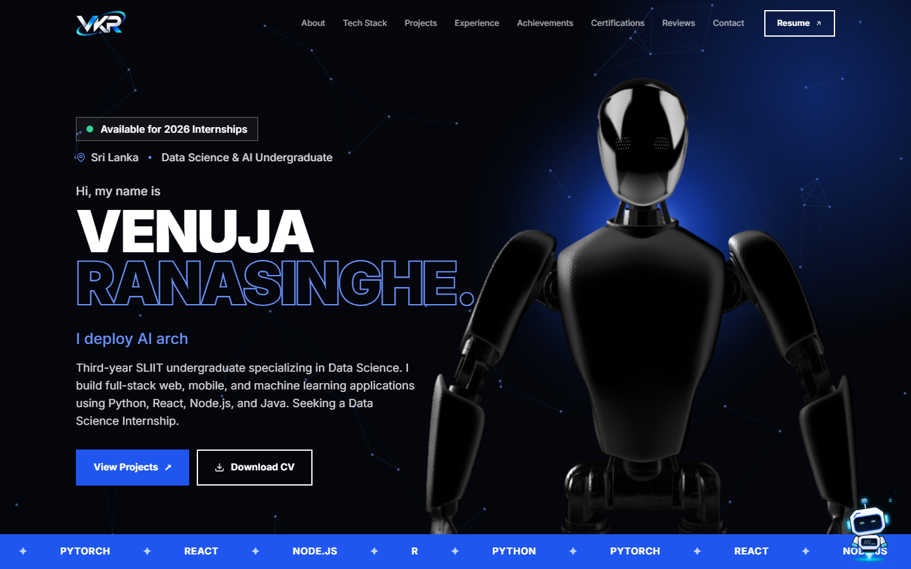

<div align="center">

# Venuja Ranasinghe — Portfolio

**Data Science & AI undergraduate at SLIIT, building machine learning, web and mobile applications.**

[](https://github.com/vranasinghe/portfolio/actions/workflows/ci.yml)
[](https://nextjs.org/)
[](https://react.dev/)
[](https://www.typescriptlang.org/)
[](https://tailwindcss.com/)

[**Live site**](https://www.venuja.online) · [**LinkedIn**](https://www.linkedin.com/in/venuja-ranasinghe-522a63423/) · [**GitHub**](https://github.com/vranasinghe) · [**Email**](mailto:venujaranasinghe26@gmail.com)

<a href="https://www.venuja.online">
  
</a>

</div>

## Overview

This is the source code of my personal portfolio. It presents my projects, skills, experience and certifications, and includes the server features behind them: a contact form, an invite-only client review system, GitHub activity and a built-in portfolio guide.

I am currently looking for a **Data Science internship**.

## Features

- **Interactive hero** — a Spline 3D robot, an animated node-network background and a typewriter introduction.
- **Project showcase** — featured case studies and a category-filtered gallery.
- **Vee, the portfolio guide** — a chat assistant that answers from the portfolio's own data. When Gemini is configured, it only matches the question to a topic; without it, Vee uses scripted matching.
- **Contact form** — server-side email delivery through Resend, with input validation and rate limiting.
- **Client reviews** — single-use invite links, published to Supabase on submission, with a password-protected admin page.
- **GitHub activity** — a contribution calendar read from the GitHub GraphQL API and cached for an hour.
- **Accessible and responsive** — mobile-first layouts that respect the reduced-motion preference.

## Tech stack

| Area | Technology |
|---|---|
| Framework | Next.js 15 (App Router), React 19, TypeScript |
| Styling and motion | Tailwind CSS, Framer Motion |
| 3D | Spline |
| Services | Resend (email), Supabase (reviews), GitHub GraphQL, Google Gemini |
| Delivery | Vercel, GitHub Actions |

## Featured projects

| Project | Built with | Links |
|---|---|---|
| **ChestAI Diagnostics** | PyTorch, FastAPI, React | [Code](https://github.com/vranasinghe/ChestAI_Diagnostics) · [Live](https://chest-ai-diagnostics.vercel.app) |
| **Multi-Tenant AI Support Platform (RAG)** | Next.js, FastAPI, PostgreSQL, pgvector | [Code](https://github.com/vranasinghe/Multi-Tenant-AI-Customer-Support-Platform-with-RAG) · [Demo](https://youtu.be/UW0GiOQAywc) |
| **DengueRisk** | Python, Scikit-learn, GeoPandas | [Live](https://macromaster101.github.io/DengueRisk/dashboard/) |
| **CommerceLens** | Python, SQL Server, SSIS, Power BI | [Demo](https://www.youtube.com/watch?v=fqMp3b7j_TQ) |
| **Aura Space** | React, Vite, Supabase | [Code](https://github.com/vranasinghe/Real-state-project) · [Live](https://real-state-project-gamma.vercel.app) |
| **Bright Future Voting Platform** | Spring Boot, React, Docker | [Code](https://github.com/vranasinghe/web-voting-system) · [Live](https://web-voting-system.vercel.app/) |

More work is listed on the [live site](https://www.venuja.online/#projects).

## Getting started

**Requirements:** Node.js 20 or newer, and npm.

```bash
git clone https://github.com/vranasinghe/portfolio.git
cd portfolio
npm install
cp .env.example .env.local   # PowerShell: Copy-Item .env.example .env.local
npm run dev
```

Open <http://localhost:3000>. The site runs without any keys; each service below stays unavailable or falls back until it is configured.

### Environment variables

Set these in `.env.local`, and in your hosting provider for deployments. All except `NEXT_PUBLIC_SHOW_REVIEWS` are server-only — never prefix them with `NEXT_PUBLIC_`.

| Variable | Used for | Notes |
|---|---|---|
| `RESEND_API_KEY` | Contact and review emails | Required for the contact form |
| `CONTACT_TO_EMAIL` | Inbox that receives messages | Required for the contact form |
| `CONTACT_FROM_EMAIL` | Sender address | Optional; use a verified domain in production |
| `SUPABASE_URL` | Review storage | Project URL |
| `SUPABASE_SECRET_KEY` | Review storage | `sb_secret_...` key; `SUPABASE_SERVICE_ROLE_KEY` also works |
| `REVIEW_INVITE_SECRET` | Signing invite links and admin sessions | At least 32 characters |
| `ADMIN_PASSWORD` | Review admin pages | Use a long password |
| `GITHUB_TOKEN` | GitHub activity | Must be able to read contributions through GraphQL |
| `GITHUB_USERNAME` | GitHub activity | Defaults to `vranasinghe` |
| `GEMINI_API_KEY` | Vee | Optional |
| `GEMINI_MODEL` | Vee | Optional; defaults to `gemini-flash-latest` |
| `NEXT_PUBLIC_SHOW_REVIEWS` | Reviews section | Set to `false` to hide it |

## Scripts

| Command | Description |
|---|---|
| `npm run dev` | Start the development server |
| `npm run build` | Create a production build |
| `npm run start` | Serve the production build |
| `npm test` | Run the regression checks (external services are mocked) |
| `npm run typecheck` | Type-check with TypeScript |

Every pull request to `main` runs the tests, type check and build in GitHub Actions.

## Project structure

```text
app/           Pages and API routes
components/    UI sections and widgets
data/          Portfolio content (portfolio.ts) and bundled reviews
lib/           Helpers: reviews, sessions, email, request safety
public/        Images and résumé
scripts/       Regression checks
supabase/      Database schema for reviews
docs/          Planning and implementation notes
```

Most content — profile, skills, projects, experience, education, certifications and achievements — is edited in [`data/portfolio.ts`](data/portfolio.ts).

## API routes

| Route | Method | Purpose |
|---|---|---|
| `/api/contact` | `POST` | Send a contact message |
| `/api/reviews` | `GET`, `POST` | List published reviews; submit one with an invite |
| `/api/github-activity` | `GET` | Contribution calendar for a year |
| `/api/vee` | `POST` | Ask the portfolio guide |
| `/api/admin/*` | Various | Login, invite links and review management |

## Client reviews

**Setup**

1. Create a Supabase project and run [`supabase/reviews.sql`](supabase/reviews.sql) in its SQL Editor. Row Level Security stays on with no policies, so only the site's server can access reviews.
2. Set the Supabase variables, `REVIEW_INVITE_SECRET` and `ADMIN_PASSWORD`.

**Use**

1. Open `/admin/review-link`, log in and create a link for a client.
2. The client submits the form, and the review appears on the site straight away. Each link works once.
3. Open `/admin/reviews` to delete a review. To hide one instead, set its `status` to `hidden` in Supabase.

**Good to know**

- Reviews added by hand to `data/approvedReviews.json` are shown too, and are the fallback if Supabase is unreachable.
- Free Supabase projects pause after about a week of inactivity; resume the project from its dashboard.
- Changing `REVIEW_INVITE_SECRET` cancels all invite links and logs out all admin sessions.
- Rate limits are kept per server process. Add hosting-level limits and provider quotas for stronger protection.

## Contact

I am open to internship opportunities and collaboration.

- Email: [venujaranasinghe26@gmail.com](mailto:venujaranasinghe26@gmail.com)
- LinkedIn: [Venuja Ranasinghe](https://www.linkedin.com/in/venuja-ranasinghe-522a63423/)
- GitHub: [@vranasinghe](https://github.com/vranasinghe)
- Instagram: [@venujaranasinghe](https://instagram.com/venujaranasinghe)

## License

Copyright © 2026 Venuja Ranasinghe. **All rights reserved.**

The code is public for viewing and evaluation only. It may not be copied, reused or redeployed without written permission. See [LICENSE](LICENSE).
